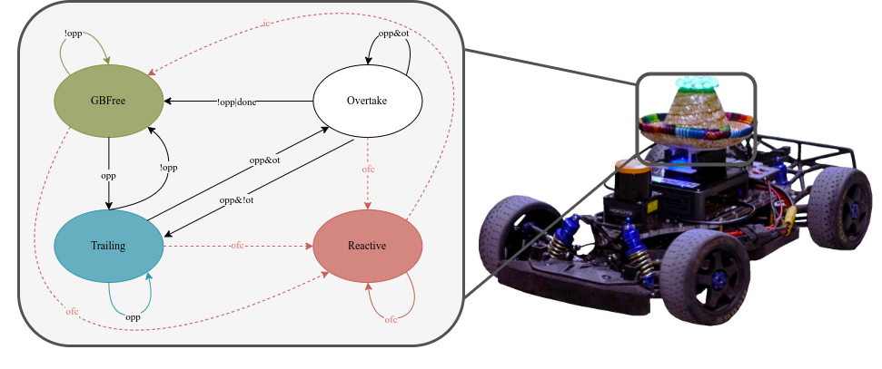

# State Machine

This node implements a state machine to effectively incorparate both `time_trials_launch.xml` behaviors as well as `head_to_head_launch.xml`. 
**TODO:** reintegrate state_indicator

## Description
The main node of the state machine is implemented in [`state_machine.py`](./rs_state_machine/state_machine.py) file. This node is responsible for subscribing/publishing to the necessary topics, and computing the conditions necessary for the state transitions.

The state transitions are declared as tables at the top of [`state_machine.py`](./rs_state_machine/state_machine.py): per state, an ordered list of (guard, next state) where the first guard that holds wins. What happens in the states (how the local waypoints are generated for the controller) is implemented in the local planner.

A simplified version of the state machine is shown in the figure below.

## Parameters
- `lateral_width_gb_m`: Width in meters of the area considered around the global raceline for computing if it is free of obstacles.
- `lateral_width_ot_m`: Width in meters of the area considered around the local raceline for computing if it is free of obstacles.
- `splini_hyst_timer_sec`: Time that overtake state is blocked when switching side for overtaking
- `splini_ttl`: Tim to live in seconds for a cached overtaking trajectory
- `emergency_break_horizon`: Distance to obstacle at which emergency break flag is triggered in meters. NOTE: no emergency break behaviour is currently implemented.

## Input/Output topic signature
The node subscribes to:
- `/car_state/frenet`: Car's state in Frenet coordinates (`rs_msgs/FrenetState`).
- `/global_waypoints_scaled`: Scaled global waypoints.
- `/perception/obstacles`: Obstacle array.
- `/planner/avoidance/otwpnts`: Splined waypoints, from the spliner node.

The node publishes to:
- `local_waypoints`: Local waypoints used by the controller.
- `local_waypoints/markers`: Local waypoints markers for RVIZ visualization.
- `state`: Current race state as `rs_msgs/RaceState`, for informing every other node of the current state.
- `/state_machine/latency`: Latency of the state machine node. (only if measuring is enabled)