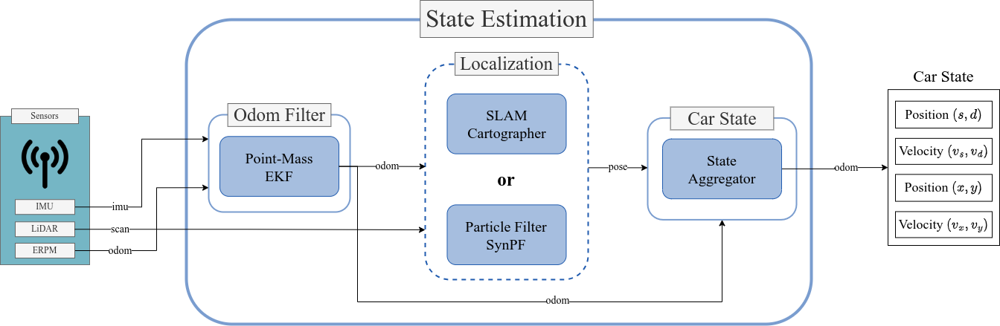

# State Estimation


This directory contains the all required files to launch the state estimation submodule, including Google's *cartographer* localization framework, the Extended Kalan Filter for velocity estimation. This includes the relevant launchers, configuration files, and scripts. 

The main launcher for the state estimation components can be found in `state_estimation/launch/state_estimation_launch.xml`. 

The resulting car state is exposed as:
- TF `map -> base_link` (and the alias `car_state/base_link`): the car pose from localization.
- `/car_state/pose`: the same pose as `PoseStamped`, published by `carstate_node` on the physical car (the simulator publishes it directly).
- `/state_estimation/odom`: velocity estimate from the EKF (twist in the `base_link` frame).
- `/car_state/frenet/odom`: pose and velocity in the Frenet frame, published by the `frenet_odom_republisher` node (`utilities/nodes/frenet_odom_republisher`), which combines the TF pose with `/state_estimation/odom`. Launched for both simulation and the physical car by `stack_master/launch/base_system_launch.xml`.

## Recording and offline evaluation ##

Record a bag on the car with `state_estimation/eval/record_bag.sh <name>` (all topics except the compressed camera
streams, into `bags/<name>`). With motion capture, record the ground truth on the mocap PC into a second bag, e.g.
`ros2 bag record /nuc6/pose /nuc6/twist -o <name>_gt` (recording the car topics over WiFi stalls the car's publishers).
Replay the bag through the stack headlessly and get plots and metrics (see `eval/README.md`):
```
USE_VIO=true python3 state_estimation/eval/run_eval.py bags/<name> --gt-bag bags/<name>_gt --map <map>
```
To watch a replay in RViz instead: `ros2 launch stack_master bag_replay_launch.xml bag:=<abs path> map_name:=<map>`
(same recomputation, args `run_vio`, `vesc_odom_from_bag`, `static_tf_from_bag`, `mapping`, `rate`, `start_offset`).

### Tuning experiments

Everything derived is recomputed in the replay, so these can be tuned from one bag: `process_noise_covariance` and the
sensor configs in `config/ekf.yaml`, the VESC twist covariance (`vesc_to_odom.cpp`, needs a build), the Basalt
covariances (`basalt_to_ekf_node.py`), `gyro_bias` / `gyro_scale` in `stack_master/config/<car>/imu.yaml` (see IMU calibration below), `speed_to_erpm_gain` in
`vesc.yaml` and the sensor mounts in `static_transforms.yaml`. Not tunable offline: the LiDAR stamp (`default_user_latency` in `sensors.yaml`), it is in
the recording. Change one value, run with `USE_VIO=true` and `USE_VIO=false`, compare `summary.md` of the runs: EKF
velocity rmse and 1 s RPE against the reference (local accuracy), map->odom correction rate and yaw drift (how much
cartographer has to fix), the "inputs vs reference" block (scale and lag of each sensor). Use several bags (slow, fast,
both turn directions): a value that wins on one track can lose on another.

### IMU calibration
Two scripts produce the values of `stack_master/config/<car>/imu.yaml` (used by `imu_to_base_node`), no ROS needed:
```shell
python3 state_estimation/scripts/imu_bias.py bags/standstill                                  # -> gyro_bias
python3 state_estimation/scripts/imu_scale.py bags/<drive> [--gt-bag bags/<gt>] [--car NUCx]   # -> gyro_scale
```
* `gyro_bias`: mean raw gyro at rest, in the IMU frame. Record 30-60 s with `record_bag.sh` with the car on the
  ground, motor off, untouched. The script refuses a bag with motion. Temperature dependent, re-measure when the odom
  frame turns at standstill.
* `gyro_scale`: net yaw of a reference divided by the integrated, bias-corrected raw gyro yaw over the same time.
  Reference: the mocap pose `/<car>/pose` (from `--gt-bag` or the bag itself) or, without mocap, cartographer's
  `/tracked_pose` from a drive localised on a good map. Only the net yaw is used, so the reference frame does not matter.
  Drive whole laps in one direction, at least 5 revolutions (the error grows with the turned angle, the reference noise
  does not): 10 laps of a 0.5 % error are 18 deg. The script prints the scale of each half of the bag as a sanity check
  and subtracts the bias of `imu.yaml` first, so measure the bias before the scale. Expect the same value from several
  bags within ~0.1 %; a drift of the odom frame while circling (`map->odom yaw drift` in a run's summary) is what is
  left after correction.

## Kalman Filter ##

The Kalman Filter is implemented using the `robot_localization` package published [here](https://github.com/cra-ros-pkg/robot_localization) [see our paper for reference]. 

During operation, the EKF is launched in EKF python launch file, called by the aforementioned main State Estimaiton launch file. The EKF launch file is located in `state_estimation/launch/ekf_launch.py`.

### Parameters

The parameters associated with the EKF can be modified in the configuration file located in `state_estimation/config/ekf.yaml`.

The parameters relevant to the EKF, responsible for generating the velocity estimates, can in this case be subdivided into two categories: the covariances $\sigma_{i}^2 \in [0, \infty)$ associated with observations (zero elements are handled by the *robot_localization* package) and the configuration parameters which dictate what sources are to be considered by the EKF. 
    
The `robot_localization` sensor fusion EKF configuration parameters are defined according to the associated publication as:
    
$$ 
\verb|config| =
\begin{bmatrix}
    x & y & z \\
    roll & pitch & yaw \\
    vx & vy & vz \\
    vax & vay & vaz \\
    alx & aly & alz \\
\end{bmatrix} 
$$

where each entry is of type boolean, indicating whether or not the associated data source should be considered by the filter.

The EKF parameters intended for tuning are summarized as follows:

- $[\sigma_{VESC,x}, \sigma_{VESC,y}, \sigma_{VESC,\psi}] = [0.25, 0.5, 0.4]$ - the covariances associated with VESC control odometry x position, y position, and yaw angle, respectively.
- $[\sigma_{VESC,vx}, \sigma_{VESC,vy}, \sigma_{VESC,vaz}] = [0.02, 0.05, 0.0]$ - the covariances associated with VESC control odometry longitudinal, lateral, and angular yaw velocities, respectively.
- $[\sigma_{IMU,al}, \sigma_{IMU,va}, \sigma_{IMU,q}] = [0.0,0.0,0.0]$ - the covariances associated with IMU linear acceleration, angular velocity, and orientation measurements, respectively.
- The EKF configuration matrix for the VESC control odometry is defined as:
$$
\verb|config_odom| = 
\begin{bmatrix}
    \verb|false| & \verb|false| & \verb|false| \\
    \verb|false| & \verb|false| & \verb|false| \\
    \verb|true| & \verb|true| & \verb|false| \\
    \verb|false| & \verb|false| & \verb|false| \\
    \verb|false| & \verb|false| & \verb|false| \\
\end{bmatrix}
$$
- The EKF configuration matrix for the IMU is defined as:
$$
\verb|config_imu| = 
\begin{bmatrix}
    \verb|false| & \verb|false| & \verb|false| \\
    \verb|false| & \verb|false| & \verb|true| \\
    \verb|false| & \verb|false| & \verb|false| \\
    \verb|false| & \verb|false| & \verb|true| \\
    \verb|false| & \verb|false| & \verb|false| \\
\end{bmatrix}
$$

## EKF / UKF Velocity Estimation Nodes ##

In addition to the `robot_localization`-based EKF above, the package ships its own `ekf_node` and `ukf_node` executables (Extended/Unscented Kalman Filter, using [FilterPy](https://github.com/rlabbe/filterpy)). They fuse IMU and VESC odometry (with Ackermann drive commands as control input for some models) into a local pose/odometry estimate. Sensors can be de-weighted by inflating their covariance instead of removing them, keeping the node structure generic.

Motion models are implemented as interchangeable classes with a common interface:
- `state_estimation/ekf_node/models.py` — point-mass, kinematic bicycle, and single-track models
- `state_estimation/ukf_node/models.py` — single-track model

Each node is launched standalone via its own launch file, both part of this package:
```
ros2 launch state_estimation ekf_node_launch.py
ros2 launch state_estimation ukf_node_launch.py
```

## Localization ##

With the ROS2 race-stack, you can currently only use Google's *cartographer* localization framework outlined [here](https://google-cartographer-ros.readthedocs.io/en/latest/) [see our paper for reference]. 

The localization package is launched via the aformentioned main state estimation launch file located under `state_estimation/launch/state_estimation_launch.xml`. 

### Parameters

The parameters associated with SLAM localization can be modified in the configuration files located under `stack_master/config/[racecar_version]/slam/`, where `[racecar_version]` is the subfolder corresponding to the vehicle in question. When mapping, edit the `f110_2d.lua` (for Mapping) or `f110_2d_loc.lua` (for Localization) file.

Based on our trust on Odometry values:
- `TRAJECTORY_BUILDER_2D.ceres_scan_matcher.rotation_weight`
- `TRAJECTORY_BUILDER_2D.ceres_scan_matcher.translation_weight`

These weight the cost of rotating/translating incoming scans (from the odometry reference). If we trust our odometry, we can weight these values a little higher, but if not (our IMU and `vesc/odom` values aren't great at the moment) the default values are `0.2`.

- `POSE_GRAPH.optimization_problem.odometry_rotation_weight`
- `POSE_GRAPH.optimization_problem.odometry_translation_weight`

These weight how much the pose graph weights odometry (over scan matching). Similarly to above, but when performing localization of the car. Default values are `0`.

Based on our trust of LIDAR scans:
- `TRAJECTORY_BUILDER_2D.submaps.range_data_inserter.probability_grid_range_data_inserter.hit_probability`
`TRAJECTORY_BUILDER_2D.submaps.range_data_inserter.probability_grid_range_data_inserter.miss_probability`

These weight the probability of a hit or miss in the occupancy grid.
- Hit probability: The trust in cells where we get range data
- Miss probability: The trust in cells where we observe free space

If we don't trust the lidar (eg. black tubes), we should reduce the miss probability (free space may mean undetected things).

